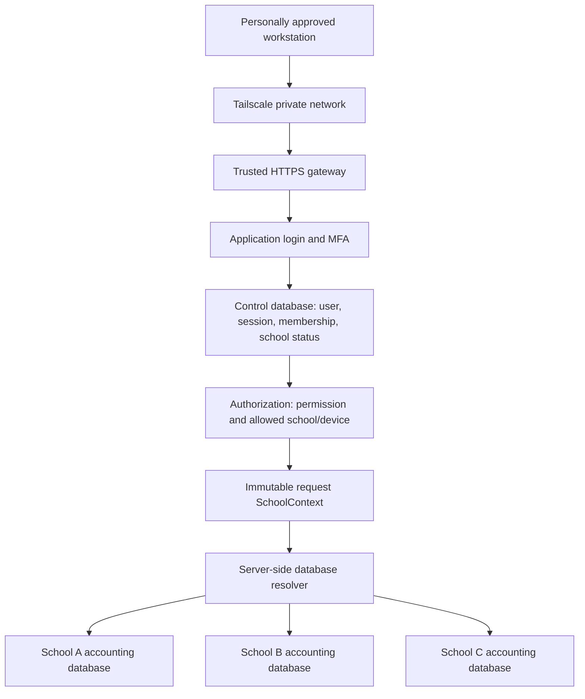

# School-level isolation design

Status: **proposed design, not implemented**. Applies to the existing React / .NET 10 / PostgreSQL application. The current app still has no authentication and uses one shared workspace; this document does not make it safe to onboard multiple schools yet.

## Decision

Use **a separate accounting database for each school**, with a central **control database** for identities, sessions, school registrations and access assignments. Run one web application initially. Use Tailscale device approval as a separate private-network entrance; application authorization remains mandatory.

Default assumptions: one named active school operator per school, potentially more than one personally approved workstation, and an initial rollout small enough to operate separate databases. A replacement operator gets a new named account; the previous account is disabled rather than shared or renamed to erase accountability. The model supports extra read-only/reviewer memberships later.

This fits the current application better than immediately adding SchoolId to every shared table: its data store reads the entire ledger and replaces business tables during saves. Database separation gives existing relationships a clear boundary, allows the same account codes/document numbers in different schools, and simplifies restoring one school's books. It also adds provisioning, migration, backup and connection-pool overhead. Reassess that operational cost before a large rollout; do not silently replace this boundary with an untested shared database.

A future shared-database alternative would need school_id on every owned row, composite foreign keys including school_id, scoped uniqueness, PostgreSQL row-level security, non-owner/non-BYPASSRLS runtime roles, transaction-local tenant settings and connection-pool reset tests. It is not the default recommendation for this prototype.

## Access flow



The resolver chooses **one** school database per request. The arrows represent alternatives, not a query across all databases. A school operator receives no school-switching control. A URL, query parameter, cookie field or request body supplied by the browser cannot grant another school or select a connection string.

Example: a School A operator requesting a known School B bank/document/export ID gets a generic 404; the request is evaluated only in School A's database. Setting schoolId in JSON must be rejected or ignored as an authority source. An ID copied from another school is never sufficient access.

## Security boundaries

1. **Network/device admission:** personally approved Tailscale members and nodes may reach private HTTPS. No public backend URL, database port, subnet-router shortcut for unapproved workstations, or public export bucket may bypass it.
2. **Authentication:** invited account, MFA and an active server-side session identify the person. Tailscale login and application login are distinct unless an explicitly implemented identity-provider integration binds them.
3. **Authorization:** active user + active school + active membership + required permission determine which accounting database and operations are allowed.
4. **Database separation:** school-specific runtime credentials and database identity verification contain ordinary record-lookup mistakes and prevent cross-database joins/foreign keys in the application data model.
5. **Output isolation:** reports, files, jobs, caches, logs and backups carry the same immutable school context.

The owner of the PostgreSQL cluster, server administrators, and a fully compromised application/secret-management service remain privileged. Separate databases do not remove those powers. Already downloaded documents cannot be revoked from a user's computer.

## Control database

Use ASP.NET Core Identity on .NET 10 with the PostgreSQL provider, or an organization-approved OpenID Connect provider with stable issuer/subject bindings. Recommended initial local identity implementation: ASP.NET Core Identity, administrator invitations, TOTP MFA and encrypted server-side cookie sessions. Do not write a custom password-hashing system. Public self-registration is disabled.

| Logical table | Fields and constraints | Access |
|---|---|---|
| Identity users / MFA / recovery | Framework-managed stable user ID, password hash or external issuer+subject, security stamp, enabled/lockout state | Identity service only; never returned as accounting state |
| schools | Internal UUID, verified school code, registered name, enabled status, created-by/time | Platform administrator |
| school_memberships | User ID, school UUID, role, status, membership version, primary-operator flag, approval actor/time | Administrator manages; runtime checks |
| school_database_directory | School UUID, opaque database name, credential-secret reference, provisioning state, expected schema version | Server-side resolver only |
| sessions | Opaque session ID hash, user, active school/context, membership/security version, expiry, last MFA, revoked state | Server-side auth checks |
| approved_devices | Verified stable device identity, status, optional school scope, approving administrator/time and revocation time | Device-access service / administrator |
| support_grants | Admin user, school, allowed operations, reason, expiry, approval/reference | Explicit support access only |
| provisioning_jobs | School, operation, idempotency key, state, schema version and non-secret error summary | Provisioning worker |
| platform_audit_events | Actor, target school, action, outcome, timestamp, correlation ID, verified device reference | Append-only service; authorized audit viewer |

For the initial policy, enforce one active primary operator per school and at most one active primary-school assignment per school operator with partial unique indexes on enabled membership rows. Extra reviewer memberships are distinct from the primary operator and require explicit approval. Disabling a user must also revoke sessions and disable relevant memberships; do not depend on a UI-only uniqueness check.

School UUID is the internal security identifier. The DepEd school code is validated registration metadata, not a credential. School users cannot change their registered identity to impersonate another school. School name/code in report headers come from the authorized school registry; school-local settings continue to hold operational details such as signatories, sub-office and bank/report mappings.

## Accounting databases

Example internal names: ledger_school_<opaque_uuid>. Database names are generated by the server, not derived from arbitrary user input. Connection strings and secret references never appear in React, API responses or report files.

Each school retains the existing accounting schema and its own schema_versions. All existing tables are school-owned:

| Scope | Existing tables |
|---|---|
| Accounting setup | accounts, cards, items, signatory_assignments, module_access, atc_codes |
| Transactions | documents, journal_lines, document_signatories |
| Banking | banks, check_ranges |
| Canteen reporting | canteen_settings, canteen_inputs, canteen_submissions |
| Persistence/schema metadata | store_state, schema_versions |

No table above is read from a shared live-school snapshot. ATC/account templates may later have a versioned, read-only central catalogue, but copying a template never copies another school's transactions or private data. Current unverified ATC examples must retain their verification status.

Add two protected structures per school:

- **tenant_identity:** a single immutable school UUID, provisioned by the deployment worker. The runtime role may read it but cannot insert/update/delete it. Each opened request connection verifies that it matches SchoolContext before business data is read or written. A directory/configuration mismatch fails closed and creates an alert.
- **audit_events and audit_outbox:** append-only accounting actions with server-derived actor/school/device references, transaction/document IDs, UTC time, outcome and correlation ID. The audit insert and business mutation commit together. The outbox can forward events centrally without relying on a cross-database transaction. Store only necessary change details and redact secrets; snapshot-table replacement must never delete these structures.

Control user IDs are validated by the application; PostgreSQL cannot enforce foreign keys across databases. Preserve stable actor IDs and display-name snapshots in audit records even after an account is disabled.

### Database privileges

Use separate school runtime roles, for example app_school_a and app_school_b. Each may connect only to its assigned database and has only required business-table privileges. It cannot create/drop databases, manage roles, modify tenant_identity, run migrations or edit/delete audit history.

A separate provisioning/migration identity owns schema changes. Its credentials are not present in the request-serving application. The control database uses another runtime identity with no ledger access.

PostgreSQL grants CONNECT to PUBLIC by default: explicitly revoke that default on **every** accounting/control database and grant only intended roles. Restrict schema creation and default privileges too. Do not reuse the local Docker superuser ledger account for a shared deployment. Network restrictions still apply to PostgreSQL itself.

Illustrative privilege shape (not an executable deployment migration):

```sql
REVOKE ALL ON DATABASE ledger_school_a FROM PUBLIC;
GRANT CONNECT ON DATABASE ledger_school_a TO app_school_a;
-- In this database, schema owner grants only the required table/sequence/function
-- privileges to app_school_a, with no role membership in other school roles.
-- Configure future-object default privileges through the schema owner as well.
```

Request-time code must not use a superuser connection to CREATE DATABASE or apply migrations. New-school creation is an asynchronous, idempotent administrator operation executed by the separate provisioning worker. A school remains Provisioning/Unavailable until marker, schema, role grants and smoke checks pass.

## .NET request handling

Proposed interfaces:

```csharp
public sealed record SchoolContext(
    Guid SchoolId,
    string UserId,
    string MembershipId,
    long MembershipVersion,
    string SessionId,
    string VerifiedDeviceId,
    IReadOnlySet<string> Permissions);

// Registered as scoped/request-bound, created only by trusted auth middleware.
public interface ISchoolContextAccessor { SchoolContext Required { get; } }
public interface ISchoolConnectionFactory
{
    Task<NpgsqlConnection> OpenVerifiedAsync(
        SchoolContext context, CancellationToken cancellationToken);
}
```

Order for protected routes:

1. Validate the HTTPS/private gateway path and trusted proxy configuration.
2. Authenticate the secure session and require MFA/enrollment completion.
3. Check revocation, membership and school status in the control database.
4. Validate verified-device admission/scope where that binding is enabled.
5. Resolve immutable SchoolContext from those server-side records.
6. Enforce the operation's permission.
7. Resolve the school database through the protected directory, open the corresponding restricted connection, verify tenant_identity, then execute the read/write.
8. Commit the business transaction and local audit event together; return only that school's result.

Because there is initially one operator per school, ordinary users never submit a school selector at login. An administrator/support user selects an explicitly granted school context in a separate audited support flow. A plain platform-admin role does not implicitly use the last visited school or fall back to a default database.

### Mandatory changes to this repository

- Replace Program.cs's process-wide db, sqlStore and Save closures with request-scoped school services. Never change one shared connection variable when users switch schools.
- Replace CanteenEndpoints.Map and Banking.Map callbacks that currently capture the global database with services that require SchoolContext.
- Refactor PostgresLedgerStore.Initialize: move database creation and schema migration out of the request process.
- Refactor Load/Save to require a verified school connection. Existing snapshot replacement may be retained temporarily **inside one verified school database**, guarded by its own revision and transaction. It must not operate in the control database, share a mutable snapshot between requests/schools, or delete audit/tenant metadata. Return 409 on a stale write; reload only the same school.
- Initially load a school snapshot within the request rather than caching it globally. If caching is introduced later, key snapshots, locks, revisions and invalidation by immutable school UUID; never by username alone or a shared singleton.
- Enforce authorization on every route: /api/state, setup, documents/posting, banks/check ranges, reconciliation inputs, reports, all export formats and submission tracking. Update the current Module Access settings from configuration-only to backend permission policies; a school operator cannot grant themselves platform privileges.
- Replace React's hard-coded company name with /api/session/me metadata. Show the assigned school clearly, avoid an operator school switcher, clear client state on logout/context changes, and handle 401/403 explicitly. UI visibility supplements API enforcement.
- Disable unauthenticated financial endpoints and JSON fallback in production. Production startup fails if authentication, the control directory or verified school storage is not configured. Demo/test mode is explicit, binds locally and cannot be enabled by a request/header.

## Sessions, roles and revocation

Use same-origin HTTPS for React/API. The cookie should be Secure, HttpOnly, host-only, Path=/, use an appropriate SameSite policy, and contain an opaque protected session reference rather than database credentials. Use ASP.NET Core antiforgery protection for cookie-authenticated state-changing requests; GET routes must not mutate financial state. Persist and protect Data Protection keys outside source control, sharing them appropriately if multiple API instances are added.

Suggested initial session limits: 30-minute idle timeout, 8-hour absolute timeout and fresh MFA for privileged administration/support grants. Make these configurable. Check server-side session/membership/school revocation on every protected request for the initial small deployment; revocation is not delayed until a long-lived token expires.

| Actor | Allowed scope | Intended abilities |
|---|---|---|
| School operator | One active assigned school | Setup permitted school fields, prepare/post transactions, bank setup/reconciliation, reports/exports and own submission tracking according to assigned permissions |
| School viewer/reviewer (optional later) | Explicit school membership | Read/review permitted data; no posting or setup changes |
| Platform administrator | Control plane | Invite/disable users, approve schools/devices, provision databases, grant/revoke explicit support access |
| Administrator with support grant | One selected school for a limited period | Granted read/support operations only; every access is audited |

Examples of server policies: transactions.read/create/post, reports.read/export, banks.manage, reconciliation.manage, school_settings.manage and submissions.manage. These are not trusted from request bodies. One operator cannot satisfy a genuine two-person approval requirement alone; do not label the existing signatory-name fields as independently verified approvals.

Suspending a school denies its new requests and report downloads without deleting its books. Disabling a user, revoking a session or expiring a support grant denies subsequent requests. A write already inside a transaction may finish; for suspension, stop new work and drain/review in-flight operations before declaring a completed lock. Audit the transition and its effective time.

## Devices and Tailscale

Tailscale admission answers “may this node reach the private website?” It does not itself decide which school's data an application account owns. A single shared tailnet's approved devices must still pass application authorization.

For school-specific workstation binding, maintain approved_devices with a verified node/certificate identity and allowed school. A School A account on a School B-only workstation is denied unless the administrator explicitly approves that device for School A too. An administrator workstation can have an explicit support-device scope; that does not remove the need for a support grant.

Do not trust browser fingerprints, MAC addresses, caller-supplied deviceId, X-School-Id, arbitrary Tailscale-* headers, or an account's Tailscale user name as proof of a specific node. An implementation must obtain authenticated peer identity at the private gateway, for example through a trusted Tailscale peer lookup using the verified original peer address, or a managed client certificate. Verify the chosen gateway's actual identity/proxy behavior in an integration test before relying on it. If it cannot reliably provide node identity, do not claim school-specific device binding; block that feature until a supported path is established. Strip untrusted inbound identity headers, trust only configured local proxies, and prevent direct access to the API port.

Device/node approval, user membership and application sessions are separate revocation controls. Revoke both node access and associated application sessions for a lost device. Do not assume that an approved device can never be stolen or compromised.

## Reports, background work and files

- Generate Income Statement, bank reconciliation, all canteen statements and ledgers from the verified school repository. bankId/cardId/documentId are looked up only in that database. Reused numbers/codes in another school do not create a link.
- Report branding (registered name/code), signatories, bank data, stock inputs and submission history are resolved from the same authorized school context.
- Background jobs store a server-derived school UUID, requester and permitted report parameters. Workers re-resolve active school context/credentials; download rechecks the requesting user's current membership/permission. A client cannot choose a worker connection string.
- Store generated files under private school-scoped object keys, e.g. schools/<uuid>/exports/<job-uuid>. Never put real exports/backups in wwwroot or the public sample-download directory. Downloads go through an authenticated authorized endpoint, including all PDF/DOCX/XLSX variants. Do not expose permanent public or standalone bearer URLs that bypass device/application access.
- Apply school scope to search, dropdowns, totals, errors, document/check numbering, optimistic revisions, cache keys, queues and notification payloads. Use generic cross-school/missing-object 404 responses to reduce enumeration.
- Back up each school separately with encrypted storage and restricted access. Restore into a quarantine database, verify its tenant marker and expected school, validate balances/counts/files, and only then activate its directory mapping. Revoke old connections and drain in-flight work when changing mappings. Retain a tested rollback copy. A backup of School A is never restored over School B.
- Central operational metrics should avoid financial rows, bank account numbers, passwords, connection strings, MFA secrets and report contents. Aggregate cross-school compliance reporting, if needed later, is a separate explicit admin service with authorization/audit, not unrestricted school-user queries.

## Migration from the current single workspace

Do not create an automatically executed “school isolation” SQL file for this design. The existing migrations 1–3 are single-school business schema, not an authentication/isolation boundary.

Implementation/cutover sequence:

1. Back up the current PostgreSQL database and ignored JSON data securely; record hashes, schema versions, row counts, trial-balance totals, report totals, bank/input counts and document links.
2. Have the owner explicitly identify the school that owns the current workspace, or preserve it as a Demo/Legacy workspace. Do not assign financial history to the first user who logs in and do not copy it into every school.
3. Build the control plane, identity/MFA/session flow, administrator bootstrap and explicit user/school assignments. Bootstrap secrets are supplied securely and never committed or printed as default passwords.
4. Provision the destination school database with its restricted runtime role, immutable tenant marker, existing business schema and audit structures. New other schools start with approved templates only, not the existing school's customers, banks, transactions or signatory names.
5. Copy the legacy workspace once to its assigned school, preserve document/source/card/bank links and untagged bank-reconciliation semantics, then reconcile the recorded control totals. Verify protected files and report branding too.
6. Refactor all API reads/writes/exports around SchoolContext and verify frontend identity handling. Remove anonymous production access and the process-global mutable ledger before enabling a second school.
7. Run the two-school isolation matrix below, permission tests and the existing accounting/report/banking suites. Test device and cookie/gateway behavior separately.
8. Switch to private HTTPS, enable invited accounts after acceptance checks, and retain the secured read-only legacy backup for rollback. Never run the old unauthenticated global API alongside the protected live service.

## Acceptance tests that must pass before onboarding

Create two real test databases on one PostgreSQL cluster and the same API instance. Seed different amounts and distinctive names, but intentionally reuse some account codes, document numbers, bank/check numbers and record IDs. Use real framework authentication test sessions, not a request header that bypasses auth.

| Test | Required result |
|---|---|
| Anonymous API/export request | 401; no financial data |
| Unapproved device | Cannot reach protected service, or verified device gate denies before financial routes |
| School A login, normal state/report query | Only A's metadata, transactions, settings and totals |
| A submits B schoolId/header/URL/context | Rejected; no database switch |
| A fetches/edits/posts B object ID or bankId | Generic 404/denial; B unchanged |
| A supplies a B card/account/source ID in a transaction | No cross-database relationship; validation fails unless that same ID legitimately identifies A's own object |
| A changes their school or permissions | Server refuses unauthorized identity/privilege changes |
| A and B use identical document/check numbers | Both allowed inside their own school; overlap/uniqueness rules remain local |
| A saves while B reads/writes | Separate snapshots, locks/revisions and no lost/cross-school data |
| Wrong school database is configured in directory | tenant_identity check blocks access before business reads/writes |
| A runtime credential connects to B/control database | PostgreSQL denies CONNECT/privileges |
| API restart / connection-pool reuse across schools | Identity marker and permissions verified; no context carryover |
| A requests B report job/download in every format | Denied without revealing file existence or content |
| Background job after membership/school suspension | Generation/download obeys the defined current-access policy; no public artifact bypass |
| User/device/support grant revoked | Subsequent protected requests denied; in-flight work handled as documented |
| Platform admin without support grant reads school ledger | Denied; explicit grant and audited selected context required |
| Bank, check, stock, notes, signatories and submission tracking | All isolated, not just documents |
| Audit and failed writes | Actor/school derived server-side; committed changes have audit events; rolled-back mutations do not appear committed |
| Restore one school's backup | Other school untouched, marker validated and control totals preserved |
| Existing regression suites on each school | Accounting, 34 report types/102 exports and banking rules still pass |

Current verification for this design task: existing routes, persistence implementation and all 16 existing tables were inspected. No authentication, migration or cross-school security tests have been implemented or run by creating this design document. Implementation is the next development phase.
